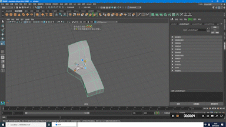
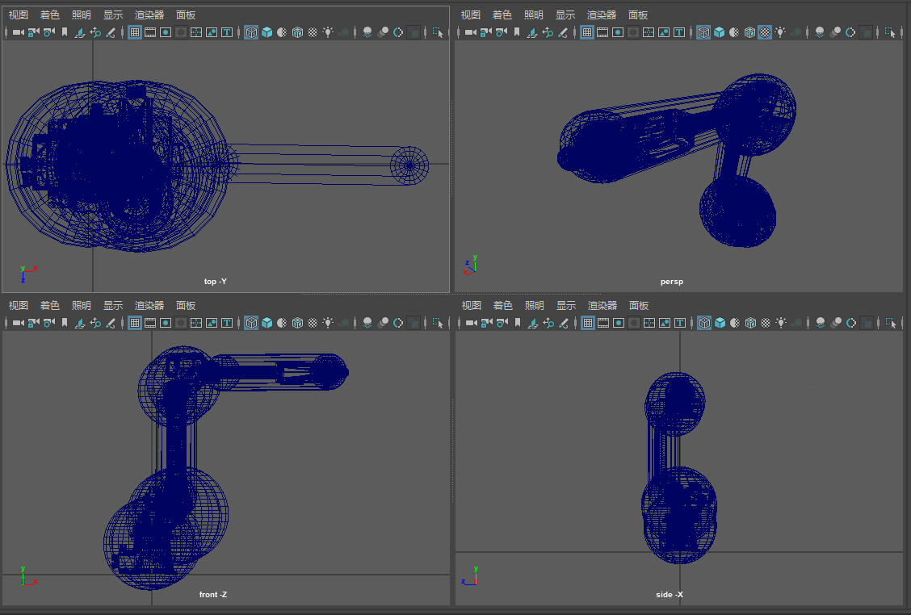

# AutoCapsuleGenerate

**Automatic bounding-capsule generation for robot arm collision checking**
Intelligent Control Lab, Carnegie Mellon University · Nov–Dec 2020



Collision checking for a robot arm is much cheaper when every link is wrapped in a simple primitive instead of a full mesh. A **capsule** — a cylinder with a hemisphere on each end — is the usual choice: the distance between two capsules reduces to a segment-to-segment distance minus the two radii.

This repo takes the mesh of each arm link (exported from Maya as `.obj`), fits a tight capsule around it with an **SVD (PCA) based** method in MATLAB / Python, and writes a Maya Python script that draws the capsules back on top of the model so the safety region can be checked visually.



## Method

For the vertices $X = \{x_i\}$ of one part ([`ComputeCapsule.m`](source/ComputeCapsule.m)):

1. **Center.** $O = \text{mean}(x_i)$.
2. **Axis.** Take the SVD of the centered points $X - O$; the capsule axis $\theta$ is the right singular vector with the largest singular value — the direction along which the part is longest.
3. **Project every vertex onto the axis.**
   - axial coordinate $t_i = \theta \cdot (x_i - O)$
   - radial distance $r_i = \lVert \theta \times (x_i - O) \rVert$
4. **Radius.** $R = \max_i r_i$, so the cylinder contains every vertex radially.
5. **Shortest segment.** A hemisphere of radius $R$ centered at axial position $c$ contains vertex $i$ when $|t_i - c| \le \sqrt{R^2 - r_i^2}$. The tightest end-sphere centers that still enclose all vertices are therefore

$$
O_R = \max_i \Big(t_i - \sqrt{R^2 - r_i^2}\Big), \qquad
O_L = \min_i \Big(t_i + \sqrt{R^2 - r_i^2}\Big)
$$

6. **Output.** Cylinder of radius $R$ and height $O_R - O_L$ along $\theta$, centered at $O + \tfrac{1}{2}(O_R + O_L)\,\theta$, plus two spheres of radius $R$ at $O + O_L\theta$ and $O + O_R\theta$.

Step 5 is what makes the capsule tight: a naive fit would put the sphere centers at the extreme vertices and overshoot both ends by up to $R$.

## Files

| File | What it does |
| --- | --- |
| [`source/ComputeCapsule.m`](source/ComputeCapsule.m) | Core function: point cloud → `R`, axis `theta`, center and both sphere centers |
| [`source/Capsule_v2.m`](source/Capsule_v2.m) | One mesh in one `.obj` → one capsule |
| [`source/Capsule_v3.m`](source/Capsule_v3.m) | One `.obj` with several groups (`g` lines) → one capsule per group |
| [`source/Capsule_v4.m`](source/Capsule_v4.m) | Parts exported as separate files `p0.obj … p6.obj` → one capsule per part |
| [`source/Capsule.py`](source/Capsule.py) | First Python prototype (NumPy/pandas): SVD axis + cylinder only, no end caps |
| [`source/genCapsule_v2.py`](source/genCapsule_v2.py) | Writes `genCapsuleAll.py`, which imports and runs every per-part Maya script |
| [`source/genCapsule.py`](source/genCapsule.py) | Example of a generated Maya script |
| [`source/obj.ipynb`](source/obj.ipynb), [`source/readObj.py`](source/readObj.py) | Notebook used to explore the `.obj` parsing and SVD fit |
| `source/model.obj`, `model.mtl`, `*.mb` | Sample model and Maya scenes used for testing |

## Usage

Requirements: MATLAB (or Python 3 with NumPy and pandas) and Autodesk Maya 2020.

1. **Export** the arm from Maya as `.obj` — either one file with each link as a group, or one file per link (`p0.obj`, `p1.obj`, …).
2. **Set paths.** The scripts read and write in `C:\Program Files\Autodesk\Maya2020\` (Maya's script folder). Change the paths at the top of the script if your Maya lives elsewhere. They also skip the first few header lines of the `.obj` (`for i = 1:4`), which matches Maya's OBJ export.
3. **Fit the capsules.** In MATLAB run `Capsule_v3` (grouped file) or `Capsule_v4` (one file per part; set the file range and `N_parts`). Each part produces `genCapsule<i>.py`.
4. **Draw them in Maya.** Run `python genCapsule_v2.py` to create `genCapsuleAll.py` (set the part count in its `range(...)`), then in Maya's Python script editor:

   ```python
   import genCapsuleAll
   ```

   For a single part:

   ```python
   import genCapsule1
   genCapsule1.run()
   ```

Each generated script is plain `maya.cmds` — a `polyCylinder` and two `polySphere`s moved into place.
